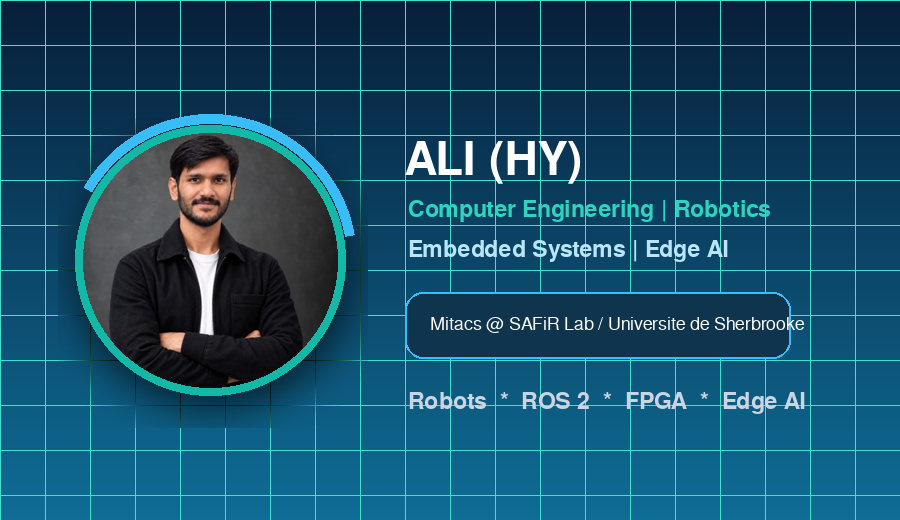

 

## About

Hi, I'm **Ali (Hy)** 👋

Final-year Computer Engineering student at **UET Taxila, Pakistan**, currently completing a **Mitacs Globalink Research Internship** at the **SAFiR Lab, Université de Sherbrooke, Canada**. I build intelligent robots across FPGA and microcontroller hardware, ROS 2 navigation, and on-device AI.

- **Project Zero:** Conscious Robotic Exploration Using Aerial Map Priors — resource-aware exploration on a Clearpath Jackal using ROS 2, Nav2, SLAM, and YOLOv8
- **Aerial vision and cost maps:** Leading the aerial perception and cost-map track for my Mitacs project and final-year project
- **Swarm robotics:** Multi-robot coordination and formation with OpenCV
- **Open-source:** Contributions to JdeRobot RoboticsAcademy and ML4SCI DeepLense
- **Goal:** Pursue fully funded graduate research in AI and robotics, with a Master's and potentially a PhD

## Experience

- Built a Mars terrain simulation environment with ROS 2, Gazebo, SLAM Toolbox, and Nav2
- Designed a single-cycle MIPS processor on FPGA
- Built EMG-based gesture control systems on embedded hardware
- Completed network operations internship at Airmax Pvt Ltd
- Earned the Google Cybersecurity Specialization

## Fellowships and Community

- Aspire Leadership Fellow — Aspire Institute, New York
- United People Global Fellow — Geneva
- Teaching and volunteer work with Umeed-e-Subah
- Member of AI R&D and other student societies

## Ventures and Goals

Co-building a software agency and a stone handicrafts startup, and creating AI and technology content under **VoiceAge Systems**. My long-term goal is to use technology and education to create positive impact in Pakistan.

## Research Interests

| Area | Current Direction |
|:--|:--|
| Artificial Intelligence | Applied machine learning and practical AI evaluation |
| Data Science | Data analysis, visualization, and evidence-based insights |
| Software Systems | Efficient, maintainable, and observable applications |
| Networking | Distributed systems, communication, and system behavior |

## Most Committed Repositories

| Rank | Repository | Commits |
|:--:|:--|--:|
| 1 | [Resource_aware_robotics_SAFiR_Lab](https://github.com/mrknowZ/Resource_aware_robotics_SAFiR_Lab) | 297 |
| 2 | [hungerzzzz](https://github.com/mrknowZ/hungerzzzz) | 21 |
| 3 | [git](https://github.com/mrknowZ/git) | 12 |
| 4 | [MyoPulse-Robotics-Hand-rasberry-pi-pico](https://github.com/mrknowZ/MyoPulse-Robotics-Hand-rasberry-pi-pico) | 10 |
| 5 | [Research-Paper-for-FYP](https://github.com/mrknowZ/Research-Paper-for-FYP) | 8 |

## Tech Stack

### Languages

### Frameworks and Tools

## Let’s Connect

Open to freelance work in AI, Python, robotics, and software development.

## GitHub Analytics

 

## Contribution Activity

## GitHub Trophies

